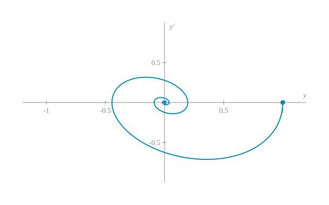

---
# ---------------------------------------------------------------------------
# NOTE TEMPLATE
#
# To start a new note:
#   1. Copy this file to notes/<short-slug>/index.qmd
#      (and example-figure.svg too, if you want to keep the figure example).
#   2. Fill in the front matter below and replace the body.
#   3. Remove `draft: true` when the note is ready to publish.
#   4. Add the note's path to the Notes sidebar in _quarto.yml, at the
#      position it should take in the reading order. Previous/next links
#      follow that order. (Never list a draft there.)
#
# The note then appears automatically in the Notes listing (newest first).
# Note-wide defaults (table of contents, numbering, code copy, citation
# previews, reading width) come from notes/_metadata.yml.
# This file lives outside notes/ and is excluded from rendering.
# ---------------------------------------------------------------------------
title: "Title of the note"
subtitle: "One-sentence dek shown in italic under the title."
description: "Short summary shown in the Notes listing."
author: "Isiaha Akatlzin Rodriguez"
date: 2026-01-01
categories: [Analysis]
draft: true
---

## Setup {#sec-setup}

Inline math uses single dollars: the map $f \colon \R^n \to \R^n$ is
continuously differentiable, and $\norm{x}$, $\abs{t}$ and $\inner{x}{y}$
use the site-wide macros from `mathjax-config.html`.

A labelled display equation is followed by `{#eq-...}`:

$$
\dot{x} = f(x), \qquad x(0) = x_0 \in \R^n.
$$ {#eq-system}

An unlabelled display equation has no attribute:

$$
\E[X] = \int_{\R} x \, \Pp(X \in \dd x).
$$

Refer to equations with `@eq-system`: see @eq-system.

## Statements {#sec-statements}

::: {#def-equilibrium}
## Equilibrium

A point $x^*$ is an *equilibrium* of @eq-system if $f(x^*) = 0$.
:::

::: {#lem-example}
A lemma uses the `lem-` prefix. The heading inside the div is optional
and gives the statement a name.
:::

::: {#prp-example}
## Optional name

A proposition uses the `prp-` prefix.
:::

::: {#thm-example}
## Optional name

A theorem uses the `thm-` prefix. Cross-reference it with `@thm-example`.
:::

::: {.proof}
A proof is an unnumbered `.proof` div. It ends with a tombstone
automatically. It may cite @lem-example and @prp-example.
:::

Other numbered environments: `cor-` (corollary), `exm-` (example),
`exr-` (exercise) and `cnj-` (conjecture). Unnumbered remarks use
`::: {.remark}`.

## Figures and tables {#sec-figures}

{#fig-example fig-alt="Alt text describing what the figure shows, for screen readers. Required; the caption is not a substitute."}

@fig-example is referenced like this. Tables put their caption and label
after the table:

| Symbol | Meaning |
|:-------|:--------|
| $\R$   | real numbers |
| $\C$   | complex numbers |
| $\N$   | natural numbers |

: Notation used in this note. {#tbl-notation}

See @tbl-notation.

## Citations and footnotes {#sec-citations}

Cite entries from `references.bib` in brackets [@perko2001], with a
locator [@perko2001, sec. 2.8], several at once [@perko2001; @strogatz2015],
or in running text as @strogatz2015.

A footnote marker goes right after the punctuation.[^first]

[^first]: Footnote text. Footnotes appear at the end of the note and as a
    preview on hover.

## Code {#sec-code}

Code blocks name their language and, optionally, a file. They get a copy
button automatically. These blocks are displayed, not executed.

```{.python filename="example.py"}
import numpy as np

A = np.array([[0.0, 1.0],
              [-1.0, -0.5]])
print(np.linalg.eigvals(A))
```

## Related notes {.unnumbered}

Link other notes by their source path; Quarto rewrites the link.

- [All notes](../index.qmd)
- [Linear stability (demonstration)](../linear-stability-demo/index.qmd)

## References {.unnumbered}

::: {#refs}
:::
